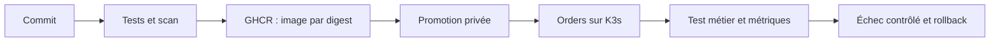

# Asteria

**Une livraison suivie du commit au service Kubernetes, avec un retour arrière vérifié.**

[Ouvrir la démonstration](https://boualili-youcef.github.io/Asteria/) ·
[Comprendre le projet](demo/README.md) · [Rejouer le parcours](demo/RUNBOOK.md)

La **Platform Console** relie un graphe d’architecture interactif, la release
vérifiée, trois replays d’incidents, le catalogue des services et le registre
des 22 constats. [Démarrer et tester le site localement](demo/web/README.md).
Les preuves sont datées ; aucun bouton du site public n’administre le cloud.

Asteria est un lab Platform Engineering sur OpenStack. Il part d'une
infrastructure fonctionnelle mais imparfaite et améliore un parcours concret :
la livraison d'Orders, une API de commandes.

## Ce qui fonctionne

| Vérification du 14 octobre 2026 | Résultat |
|---|---:|
| Promotion du nouveau digest sur K3s | 36,323 s |
| Échec readiness puis rollback vérifié | 209,505 s |
| Commandes créées, relues et archivées sur K3s | 3 sur 3 |
| Accès réseau et droits non autorisés | refusés lors des tests |

Les [preuves enregistrées](demo/evidence/kubernetes-flow-20261014.json)
relient les résultats au digest et au run CI. Le site public présente ces
preuves ; il ne déclenche aucun déploiement.

## Une infrastructure volontairement limitée

Cinq VM : un bastion, un control plane K3s, deux workers et un PostgreSQL
historique. La démo utilise un namespace séparé et ses propres PostgreSQL,
Redis et worker, avec données factices. Aucune VM supplémentaire ; aucun
accès public au cluster ; les workloads historiques restent inchangés.

Le lab consomme 9/10 vCPU et 17/20 Gio de quota Nova. Le namespace de démo
réserve 80m CPU et 288 MiB de RAM. Ce ne sont pas des garanties de performance.

## Lire le code

- [Applications](apps/) : Orders, Identity et Notifications, en Python/FastAPI.
- [Chart Orders](k8s/current-state/orders-api/chart/) : réutilisé pour la démo.
- [CI Orders](.github/workflows/orders-demo.yml) : tests, image, scan et artefact.
- [Scripts de démo](demo/scripts/) : inventaire, promotion et test métier.
- [Terraform et Ansible](infra/) : construction et configuration du lab.

## Limites assumées

Ce lab n'est ni HA ni une plateforme de production. Les données de démo sont
jetables ; leurs flux PostgreSQL/Redis internes ne sont pas chiffrés. Le worker
réutilise une image M13 contrôlée en cache. L'absence d'outbox et de DLQ reste
visible. [Détails et arbitrages](demo/README.md#limites).

L'audit AS-IS et les missions TO-BE restent conservés dans `docs/`. Le second
projet OpenStack historique est inaccessible ; T08–T18 ne sont pas déclarées
terminées par cette démo. Voir le [contexte](PROJECT_CONTEXT.md), le
[backlog](PHASE_2_BACKLOG.md) et [ADR-015](docs/adr/ADR-015-demo-v1-source-only.md).
