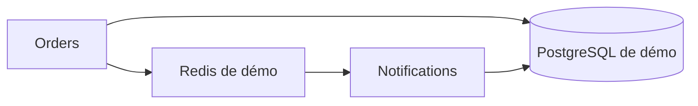

# Une release, des preuves

[Ouvrir la démo publique](https://boualili-youcef.github.io/Asteria/) ·
[Guide opérateur](RUNBOOK.md) ·
[Enregistrement K3s](evidence/kubernetes-flow-20261014.json)

Le problème de départ : la CI publiait une image, mais Kubernetes continuait
à exécuter une autre version. La démo rend ce passage vérifiable et teste
ce qui se passe quand une nouvelle révision ne devient pas prête.

## Le parcours

1. GitHub Actions teste Orders, construit son image et scanne son digest.
2. Un artefact associe le commit, le digest et le run réussi.
3. Un opérateur privé promeut cet artefact dans `asteria-demo`.
4. Le test crée une commande, la relit et retrouve son événement archivé.
5. Une readiness invalide provoque un échec ; le rollback est ensuite vérifié.

Le runner GitHub n'a aucun accès au cluster. Le site est entièrement statique.
Le recruteur n'a besoin ni de VPN, ni de compte cloud, ni de droits Kubernetes.

## Résultats observés

Le 14 octobre 2026 :

| Mesure | Résultat |
|---|---|
| CI de l'image promue | [Run 38622409565 réussi](https://github.com/Boualili-Youcef/Asteria/actions/runs/38622409565) ; 0 HIGH/CRITICAL détectée |
| Promotion K3s | 36,323 s ; image demandée et image exécutée concordantes |
| Échec et retour arrière | 209,505 s, dont un timeout Helm de 180 s ; probes vérifiées |
| Test métier après rollback | 12,151 s ; commande persistée et événement correspondant archivé |
| Contrôles réseau | client autorisé accepté ; client non autorisé et accès inter-namespaces refusés |
| Droits opérateur | accès démo autorisé ; Secrets historiques, création de namespace et suppression de nœud refusés |
| Santé finale | quatre services de démo disponibles ; trois nœuds Ready ; images historiques inchangées |

Pendant l'exercice, 64 lectures de `/health` et `/ready` ont retourné HTTP 200.
Cet échantillon ne prouve pas une disponibilité continue ou un SLO.

Une première promotion avec Helm 3.15 RC a dépassé son délai puis a été
annulée. La reprise avec Helm 3.19.0 stable a réussi. Le script impose
maintenant le client validé ; la cause profonde du premier timeout n'est pas
isolée. Les deux tentatives sont conservées dans l'enregistrement.

## Présentation en cinq minutes

1. **Une minute** : montrer le problème et le parcours Deploy sur le site.
2. **Une minute** : ouvrir le run CI et retrouver le commit et le digest.
3. **Une minute** : montrer le test métier K3s dans Applications.
4. **Deux minutes** : expliquer l'échec contrôlé, les durées et le rollback,
   puis les limites. Les boutons parcourent un enregistrement authentique.

Le démarrage initial n'est pas rejoué en visio. Le scénario est consultable
même quand le VPN ou les VM sont indisponibles. Pour le montrer en direct,
utiliser le [guide opérateur](RUNBOOK.md).

## Limites

- Un seul control plane ; PostgreSQL et Redis de démo sont uniques et
  temporaires. Aucune preuve de HA, DR ou restauration de données.
- Le chiffrement data interne est une exception limitée à ces données
  factices et à un secret neuf ; les policies réseau ne remplacent pas TLS.
- Le worker M13 reste en cache, avec téléchargement interdit. Ses sources et
  requirements correspondent au dépôt ; sa livraison n'a pas été refondue.
- Orders persiste puis publie sans outbox. Une panne peut laisser une commande
  sans événement ; Redis n'offre ici ni DLQ ni reprise robuste.
- SBOM et provenance sont produits, mais aucune signature n'est vérifiée à
  l'admission. Le scan ne constitue pas une certification de sécurité.
- Les métriques de démo sont lues directement par port-forward. Le Prometheus
  historique n'a pas été modifié. Les compteurs sont volatils.

Pour auditer les détails : [preuve de mission](../docs/evidence/phase-2/Demo-v1-local-delivery.md)
et [décision d'architecture](../docs/adr/ADR-015-demo-v1-source-only.md).
Les anciens audits restent disponibles en arrière-plan ; leur lecture n'est
pas nécessaire pour comprendre ou présenter ce parcours.
