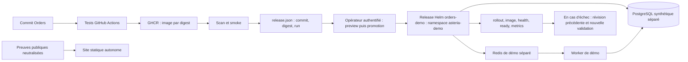

# Architecture de la démonstration

But : rendre une livraison Orders compréhensible et vérifiable avec le seul
projet source, sans construire un deuxième environnement OpenStack.

Le schéma décrit le parcours préparé. L'état effectivement exécuté figure dans
[EVIDENCE](EVIDENCE.md) ; une flèche n'est pas une preuve de déploiement.

## Frontières de confiance

GitHub construit et publie, sans accès administratif au cluster privé. La CI
émet l'artefact de promotion après tests, scan et smoke ; l'image candidate
est publiée avant le scan, mais n'est promouvable qu'après réussite du run.
Le script compare l'artefact téléchargé depuis ce run au fichier opérateur.
Ce contrôle ne remplace pas une politique d'admission vérifiant une signature.

Le poste opérateur détient son authentification privée. Son contexte et les
UID des namespaces `kube-system` et `asteria-demo` sont explicites : aucun choix
fondé sur le seul nom du contexte. Le script ne crée pas de namespace et ne
prend pas possession d'un Deployment historique. Une release déjà saine par
digest est une précondition ; le bootstrap est une opération distincte.

Le rôle proposé est borné au namespace. Helm stocke ses révisions dans des
Secrets : ce rôle peut lire et modifier les Secrets de démo. Il ne doit donc
jamais être lié à un namespace contenant des credentials historiques. Deux
lectures de Namespace par nom sont autorisées au niveau cluster pour contrôler
l'identité. Aucune permission de suppression de namespace, de nœud ou de
ClusterRole n'est donnée à l'opérateur.

## Données et réseau

Le test Docker crée un bridge dédié et quatre conteneurs identifiés par un
label unique. PostgreSQL et Redis ne publient aucun port hôte ; les APIs sont
sur la boucle locale. Le mot de passe synthétique est généré en mémoire. Les
connexions sortantes ne sont pas filtrées par ce bridge. Les
sources des images applicatives sont comparées aux fichiers Python du dépôt.
Le nettoyage retire uniquement les conteneurs du test et leurs volumes anonymes.

Pour K3s, l'isolation n'est pas déduite du nom du namespace : quota, PSA, RBAC,
NetworkPolicies et données séparées doivent être appliqués et testés dans un
bootstrap approuvé. Les manifests livrés sont une proposition, pas une preuve
de refus réseau. Ni Redis partagé ni les bases historiques ne sont des cibles
de test. Pas d'Ingress ou de NodePort pour la démo ; consultation privée par
port-forward limité à `127.0.0.1`.

## Référence entreprise et adaptation lab

Les ADR-010/011/014 décrivent GitOps, supply chain complète et répétition avant
migration. Demo v1 mesure un parcours Orders avec promotion opérateur. Aucun
contrôleur lourd n'est ajouté ; le monitoring existant est réutilisé. Le lab
reste mono-control-plane, sans preuve de HA ou DR.
